# [springboot]基于Vue框架的学生交流互助平台

> 🎓 **计算机毕业设计 · [springboot]基于Vue框架的学生交流互助平台**
>
> 本仓库只放**项目介绍 + 运行截图**（截图是站点带水印的原图，存在仓库 `images/` 里）。
>
> 👉 **完整可运行源码 / 数据库脚本 / 部署文档：[点我获取](https://geekcode.top/archives/springboot-%E5%9F%BA%E4%BA%8EVue%E6%A1%86%E6%9E%B6%E7%9A%84%E5%AD%A6%E7%94%9F%E4%BA%A4%E6%B5%81%E4%BA%92%E5%8A%A9%E5%B9%B3%E5%8F%B0?utm_source=github)**
>
> 💬 咨询微信：**ir9372**　|　🌐 更多项目：[极客代码 geekcode.top](https://geekcode.top/?utm_source=github)
>
> 📌 项目详情页：<https://geekcode.top/archives/springboot-%E5%9F%BA%E4%BA%8EVue%E6%A1%86%E6%9E%B6%E7%9A%84%E5%AD%A6%E7%94%9F%E4%BA%A4%E6%B5%81%E4%BA%92%E5%8A%A9%E5%B9%B3%E5%8F%B0?utm_source=github>

<table><td width="230" align="center"> <b>扫码加微信 ir9372</b></td><td valign="middle">📦 源码 = 项目介绍 + 全部运行截图 + 数据库 + 部署文档 👉 点上方任意截图，直接跳到 <b>极客代码 geekcode.top</b> 详情页</td></table>

---

<h1>[springboot]基于Vue框架的学生交流互助平台</h1>
<h2>项目概述</h2>

本项目旨在构建一个基于 Vue 框架与 Spring Boot 后端的学生交流互助平台，致力于解决校园信息不对称及学生间沟通不畅的问题。系统核心功能涵盖学校信息发布、入学须知管理、校规查询、在线交流社区、资料分享以及用户互动评论等模块。适用人群主要为在校大学生及潜在新生，通过提供统一的资讯获取与社交互助渠道，提升校园生活便利性与信息透明度。技术架构采用前后端分离模式，前端使用 Vue.js 实现响应式交互界面，后端基于 Spring Boot 结合 MyBatis-Plus 进行高效数据持久化处理，并引入 Shiro 框架保障系统安全性，实现了从前台用户浏览到后台管理员维护的全流程闭环管理。

<h2>技术架构</h2>
<h3>1. 整体架构设计</h3>

系统采用经典的前后端分离架构（Vue-integrated），通过 RESTful API 进行通信。

<a href="https://geekcode.top/archives/springboot-%E5%9F%BA%E4%BA%8EVue%E6%A1%86%E6%9E%B6%E7%9A%84%E5%AD%A6%E7%94%9F%E4%BA%A4%E6%B5%81%E4%BA%92%E5%8A%A9%E5%B9%B3%E5%8F%B0?utm_source=github" title="查看完整源码">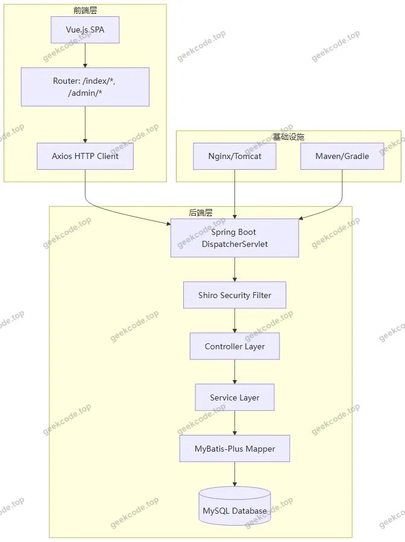</a>

<h3>2. 核心技术选型理由</h3>
<ul>
<li><strong>Spring Boot</strong>: 作为后端基础框架，利用其自动配置和起步依赖特性，快速搭建企业级应用，简化开发流程，内置 Tomcat 容器便于部署。</li>
<li><strong>MyBatis-Plus</strong>: 在 MyBatis 基础上增强，提供通用 CRUD 操作，减少样板代码，提高数据库交互效率，支持复杂查询构建。</li>
<li><strong>Apache Shiro</strong>: 轻量级安全框架，负责身份认证（Authentication）和授权（Authorization），确保只有合法用户才能访问特定资源，特别是后台管理接口。</li>
<li><strong>Vue.js</strong>: 前端采用渐进式 JavaScript 框架，组件化开发模式提升了代码复用性和可维护性，配合 Vue Router 实现单页面应用（SPA）流畅导航。</li>
<li><strong>MySQL</strong>: 关系型数据库存储结构化数据，如用户信息、帖子内容、评论记录等，保证数据一致性与完整性。</li>
</ul>
<h3>3. 数据库设计要点</h3>

根据路由和功能模块推断，数据库主要包含以下实体表：

<ul>
<li><code>yonghu</code> (用户表): 存储注册账号、密码、个人信息。</li>
<li><code>forum</code> (论坛/交流表): 存储在线交流帖子、标题、内容、发布者ID。</li>
<li><code>storeup</code> (收藏表): 记录用户对资料或帖子的收藏行为。</li>
<li><code>ziliaofenxiang</code> (资料分享表): 存储上传的学习资料文件信息及分类。</li>
<li><code>ruxuexuzhi</code> (入学须知表) &amp; <code>xiaoguixinxi</code> (校规信息表): 存储学校发布的规章制度文本。</li>
<li><code>discuss...</code> (评论表): 针对入学须知、校规等信息的用户评论数据。</li>
<li><code>xuexiaoxinxi</code> (学校信息表): 存储学校基本概况。</li>
<li><code>config</code> (配置表): 系统参数配置。</li>
</ul>
<h2>功能模块</h2>
<h3>1. 前台用户端功能</h3>

前台面向普通注册用户，提供信息浏览、互动与个人中心服务。

<table>
<thead>
<tr>
<th align="left">模块名称</th>
<th align="left">对应路由</th>
<th align="left">功能描述</th>
</tr>
</thead>
<tbody><tr>
<td align="left"><strong>首页展示</strong></td>
<td align="left"><code>/index/forumList</code></td>
<td align="left">展示最新的在线交流帖子列表，作为用户进入系统的默认视图。</td>
</tr>
<tr>
<td align="left"><strong>用户中心</strong></td>
<td align="left"><code>/index/yonghuCenter</code></td>
<td align="left">查看个人基本信息，修改个人资料，管理我的发布内容。</td>
</tr>
<tr>
<td align="left"><strong>注册登录</strong></td>
<td align="left"><code>/yonghuRegister</code>, <code>/index/yonghuDetail</code></td>
<td align="left">新用户注册入口，老用户登录验证；查看其他用户的公开详情页。</td>
</tr>
<tr>
<td align="left"><strong>在线交流</strong></td>
<td align="left"><code>/index/zaixianjiaoliuList/Add/Detail</code></td>
<td align="left">浏览交流区帖子，发布新话题，查看帖子详情及回复。</td>
</tr>
<tr>
<td align="left"><strong>资料分享</strong></td>
<td align="left"><code>/index/ziliaofenxiangList/Add/Detail</code></td>
<td align="left">浏览共享的学习资料，上传新资料，下载或查看资料详情。</td>
</tr>
<tr>
<td align="left"><strong>校规查询</strong></td>
<td align="left"><code>/index/xiaoguixinxiList/Add/Detail</code></td>
<td align="left">查阅学校规章制度，支持添加新的校规条目（视权限而定），查看详情。</td>
</tr>
<tr>
<td align="left"><strong>入学须知</strong></td>
<td align="left"><code>/index/ruxuexuzhiList/Add/Detail</code></td>
<td align="left">阅读新生入学指南及相关注意事项，支持新增须知条目。</td>
</tr>
<tr>
<td align="left"><strong>学校信息</strong></td>
<td align="left"><code>/index/xuexiaoxinxiList/Add/Detail</code></td>
<td align="left">浏览学校介绍、新闻动态等基本信息。</td>
</tr>
<tr>
<td align="left"><strong>资料类型</strong></td>
<td align="left"><code>/index/ziliaoleixingList/Add/Detail</code></td>
<td align="left">对分享的资料进行分类管理和浏览。</td>
</tr>
<tr>
<td align="left"><strong>邮件验证码</strong></td>
<td align="left"><code>/index/emailregistercodeList/Add/Detail</code></td>
<td align="left">处理注册过程中的邮箱验证码发送与校验逻辑。</td>
</tr>
<tr>
<td align="left"><strong>我的收藏</strong></td>
<td align="left"><code>/index/storeupList</code></td>
<td align="left">查看用户已收藏的资料或帖子列表。</td>
</tr>
</tbody></table>
<h3>2. 后台管理端功能</h3>

后台面向管理员，提供全量数据的增删改查及系统配置管理。

<table>
<thead>
<tr>
<th align="left">模块名称</th>
<th align="left">对应路由</th>
<th align="left">功能描述</th>
</tr>
</thead>
<tbody><tr>
<td align="left"><strong>用户管理</strong></td>
<td align="left"><code>/yonghu</code></td>
<td align="left">查看所有注册用户信息，执行禁用、删除或重置密码等操作。</td>
</tr>
<tr>
<td align="left"><strong>学校信息管理</strong></td>
<td align="left"><code>/xuexiaoxinxi</code></td>
<td align="left">维护学校官方介绍、公告等内容，支持批量导入或手动编辑。</td>
</tr>
<tr>
<td align="left"><strong>入学须知管理</strong></td>
<td align="left"><code>/ruxuexuzhi</code></td>
<td align="left">审核和管理发布的入学须知文档，确保信息准确无误。</td>
</tr>
<tr>
<td align="left"><strong>入学须知评论</strong></td>
<td align="left"><code>/discussruxuexuzhi</code></td>
<td align="left">查看用户对入学须知的评论内容，进行违规评论删除或屏蔽。</td>
</tr>
<tr>
<td align="left"><strong>在线交流管理</strong></td>
<td align="left"><code>/zaixianjiaoliu</code></td>
<td align="left">监控社区发帖情况，管理敏感词汇，删除违规帖子。</td>
</tr>
<tr>
<td align="left"><strong>资料分享管理</strong></td>
<td align="left"><code>/ziliaofenxiang</code></td>
<td align="left">审核用户上传的学习资料，管理资料分类，清理无效资源。</td>
</tr>
<tr>
<td align="left"><strong>校规信息管理</strong></td>
<td align="left"><code>/xiaoguixinxi</code></td>
<td align="left">维护校规条款，更新学校纪律要求。</td>
</tr>
<tr>
<td align="left"><strong>校规信息评论</strong></td>
<td align="left"><code>/discussxiaoguixinxi</code></td>
<td align="left">管理关于校规的讨论区评论，维护社区秩序。</td>
</tr>
<tr>
<td align="left"><strong>收藏管理</strong></td>
<td align="left"><code>/storeup</code></td>
<td align="left">查看全站用户的收藏记录，分析热门资源。</td>
</tr>
<tr>
<td align="left"><strong>论坛管理</strong></td>
<td align="left"><code>/forum</code></td>
<td align="left">综合论坛板块管理，可能涉及版块设置或置顶帖管理。</td>
</tr>
<tr>
<td align="left"><strong>资料类型管理</strong></td>
<td align="left"><code>/ziliaoleixing</code></td>
<td align="left">定义和维护资料的分类标签体系。</td>
</tr>
<tr>
<td align="left"><strong>聊天管理</strong></td>
<td align="left"><code>/chat</code></td>
<td align="left">监控即时通讯或留言板的聊天记录（如有实时交互功能）。</td>
</tr>
<tr>
<td align="left"><strong>系统配置</strong></td>
<td align="left"><code>/config</code></td>
<td align="left">修改网站名称、Logo、轮播图链接等全局系统参数。</td>
</tr>
</tbody></table>
<h2>用户角色与权限</h2>

根据 Shiro 安全框架的应用及前后端路由划分，系统主要存在两种角色：

<h3>1. 普通用户 (Student/User)</h3>
<ul>
<li><strong>权限范围</strong>: 仅可访问前台路由 (<code>/index/*</code>)。</li>
<li><strong>具体功能</strong>:</li>
<li><strong>注册/登录</strong>: 创建账号并登录系统。</li>
<li><strong>浏览</strong>: 查看所有公开的学校信息、校规、入学须知、资料分享和在线交流帖子。</li>
<li><strong>互动</strong>: 发布在线交流帖子、发表评论、上传学习资料、收藏感兴趣的内容。</li>
<li><strong>个人中心</strong>: 修改自己的个人资料，查看自己的发布记录和收藏列表。</li>
<li><strong>限制</strong>: 无法访问任何 <code>/admin</code> 开头的后台管理路由，无权直接修改或删除他人发布的内容（除非是本人发布且系统允许自删）。</li>
</ul>
<h3>2. 管理员 (Admin)</h3>
<ul>
<li><strong>权限范围</strong>: 可访问后台路由 (<code>/xxx</code>) 及部分高级前台管理功能。</li>
<li><strong>具体功能</strong>:</li>
<li><strong>全量数据管理</strong>: 对用户、学校信息、入学须知、校规、资料分享、在线交流等所有业务数据进行增、删、改、查操作。</li>
<li><strong>内容审核</strong>: 审核用户上传的资料和发布的帖子，删除违规内容。</li>
<li><strong>评论管理</strong>: 监控并管理所有模块下的用户评论，维护社区环境。</li>
<li><strong>系统配置</strong>: 修改全局系统参数，管理资料分类标签。</li>
<li><strong>用户管理</strong>: 管理注册用户状态，包括封禁违规账号。</li>
</ul>
<h2>项目特色与创新点</h2>
<ol>
<li><strong>垂直领域的精准服务</strong>: 区别于通用社交平台，本平台聚焦于“学生交流互助”这一细分场景，整合了校规、入学须知等刚性需求信息与在线交流、资料分享等柔性社交需求，形成了完整的学生服务生态。</li>
<li><strong>模块化知识管理体系</strong>: 通过“资料分享”与“资料类型”模块，建立了结构化的学习资源库。结合“在线交流”和“评论”功能，实现了从静态资源获取到动态知识探讨的闭环，促进了同伴学习（Peer Learning）。</li>
<li><strong>安全可控的社区环境</strong>: 引入 Apache Shiro 进行细粒度的权限控制，并结合后台强大的评论和内容审核机制，有效保障了校园网络环境的健康与安全，防止不良信息传播。</li>
<li><strong>前后端分离的高效体验</strong>: 采用 Vue + Spring Boot 架构，使得页面加载速度快，用户体验流畅。后台管理界面独立且功能完备，极大降低了管理员维护系统信息的成本。</li>
</ol>
<h2>部署环境</h2>

为确保系统正常运行，需准备以下软件环境：

<ul>
<li><strong>操作系统</strong>: Windows 10/11, Linux (CentOS/Ubuntu), 或 macOS。</li>
<li><strong>Java 环境</strong>: JDK 1.8 或更高版本（推荐 JDK 1.8 以兼容常见 Spring Boot 2.x 版本）。</li>
<li><strong>数据库</strong>: MySQL 5.7 或 MySQL 8.0+。需安装 MySQL Server 并配置远程连接权限。</li>
<li><strong>Web 服务器</strong>: 内置 Tomcat (由 Spring Boot Starter Web 提供)，生产环境建议搭配 Nginx 进行反向代理和静态资源托管。</li>
<li><strong>构建工具</strong>: Maven 3.6+ (用于后端依赖管理) 或 Gradle。</li>
<li><strong>前端环境</strong>: Node.js v14+ 及 npm/yarn (用于编译 Vue 前端代码)。</li>
<li><strong>浏览器</strong>: Chrome, Edge, Firefox 等现代主流浏览器。</li>
</ul>
<h2>五、技术特性</h2>
<ul>
<li>前后端集成部署，前端资源打包至后端 static 目录</li>
<li>使用 MyBatis-Plus 简化数据访问层开发</li>
<li>集成 Shiro 权限框架实现角色权限控制</li>
</ul>
<h2>六、功能模块截图</h2>
<h3>前台用户端</h3>
<h4>前台-首页</h4>

<a href="https://geekcode.top/archives/springboot-%E5%9F%BA%E4%BA%8EVue%E6%A1%86%E6%9E%B6%E7%9A%84%E5%AD%A6%E7%94%9F%E4%BA%A4%E6%B5%81%E4%BA%92%E5%8A%A9%E5%B9%B3%E5%8F%B0?utm_source=github" title="查看完整源码">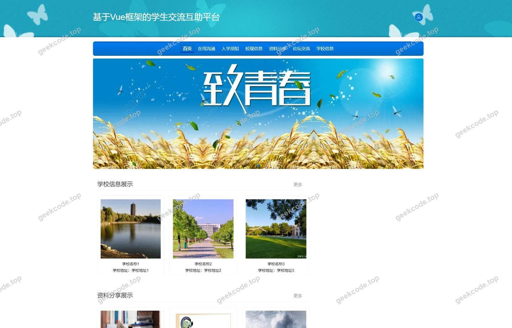</a>

<h4>前台-登录</h4>

<a href="https://geekcode.top/archives/springboot-%E5%9F%BA%E4%BA%8EVue%E6%A1%86%E6%9E%B6%E7%9A%84%E5%AD%A6%E7%94%9F%E4%BA%A4%E6%B5%81%E4%BA%92%E5%8A%A9%E5%B9%B3%E5%8F%B0?utm_source=github" title="查看完整源码">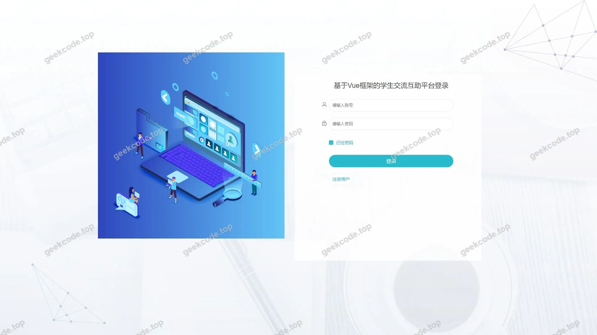</a>

<h4>前台-用户注册</h4>

<a href="https://geekcode.top/archives/springboot-%E5%9F%BA%E4%BA%8EVue%E6%A1%86%E6%9E%B6%E7%9A%84%E5%AD%A6%E7%94%9F%E4%BA%A4%E6%B5%81%E4%BA%92%E5%8A%A9%E5%B9%B3%E5%8F%B0?utm_source=github" title="查看完整源码">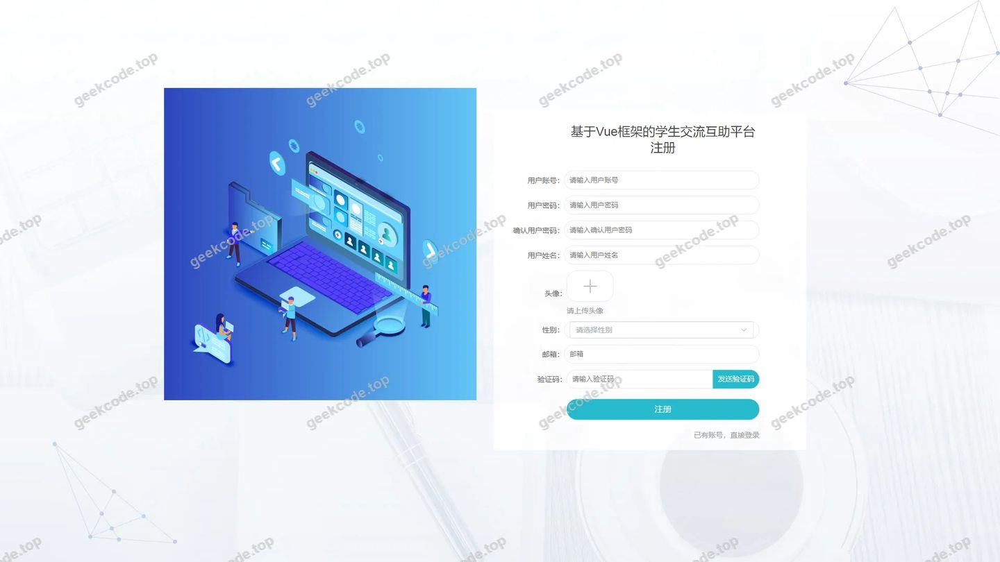</a>

<h3>后台管理端</h3>
<h4>后台-登录页</h4>

<h4>后台-入学须知评论</h4>

<a href="https://geekcode.top/archives/springboot-%E5%9F%BA%E4%BA%8EVue%E6%A1%86%E6%9E%B6%E7%9A%84%E5%AD%A6%E7%94%9F%E4%BA%A4%E6%B5%81%E4%BA%92%E5%8A%A9%E5%B9%B3%E5%8F%B0?utm_source=github" title="查看完整源码">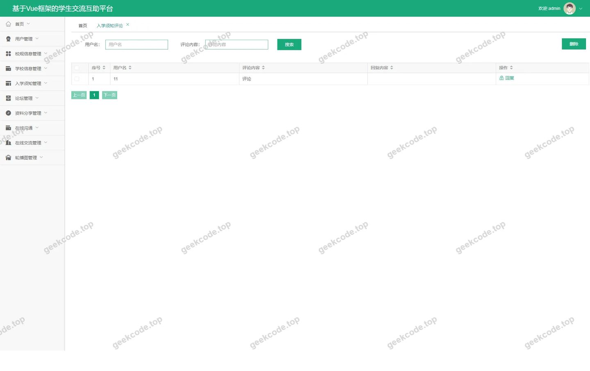</a>

<h4>页面-首页</h4>

<a href="https://geekcode.top/archives/springboot-%E5%9F%BA%E4%BA%8EVue%E6%A1%86%E6%9E%B6%E7%9A%84%E5%AD%A6%E7%94%9F%E4%BA%A4%E6%B5%81%E4%BA%92%E5%8A%A9%E5%B9%B3%E5%8F%B0?utm_source=github" title="查看完整源码">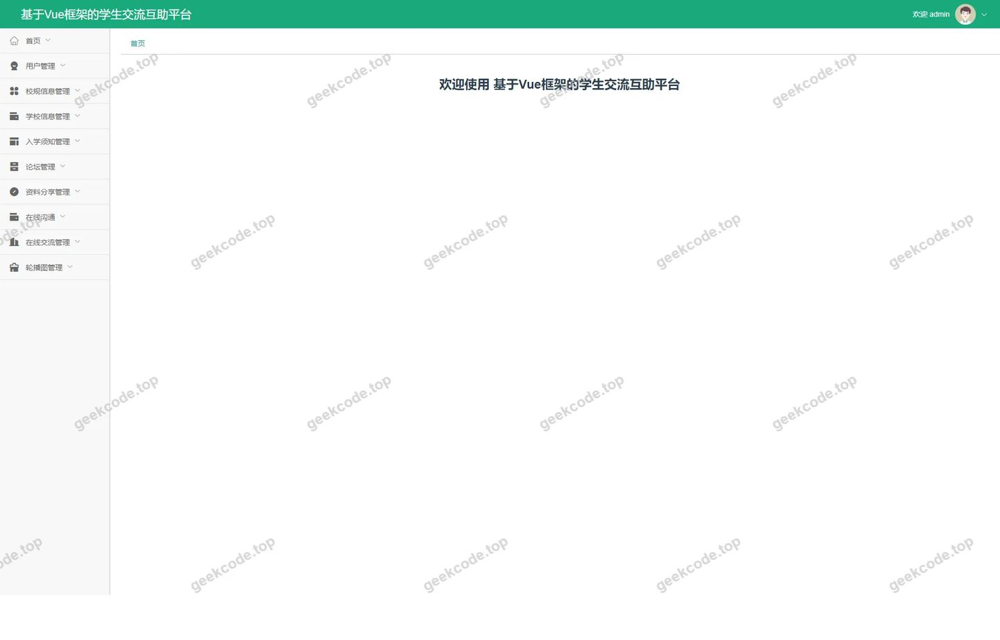</a>

<h4>后台-校规信息</h4>

<a href="https://geekcode.top/archives/springboot-%E5%9F%BA%E4%BA%8EVue%E6%A1%86%E6%9E%B6%E7%9A%84%E5%AD%A6%E7%94%9F%E4%BA%A4%E6%B5%81%E4%BA%92%E5%8A%A9%E5%B9%B3%E5%8F%B0?utm_source=github" title="查看完整源码">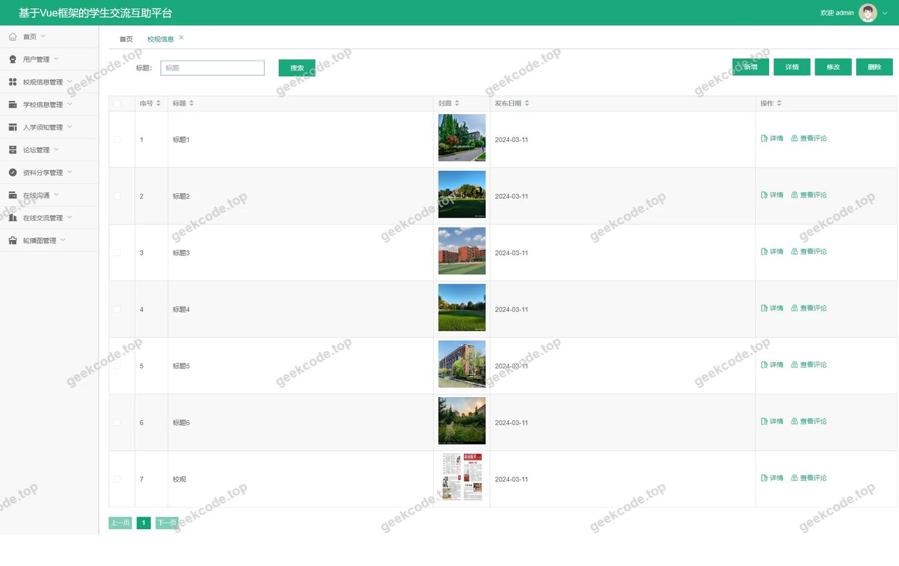</a>

<h4>后台-校规信息评论</h4>

<a href="https://geekcode.top/archives/springboot-%E5%9F%BA%E4%BA%8EVue%E6%A1%86%E6%9E%B6%E7%9A%84%E5%AD%A6%E7%94%9F%E4%BA%A4%E6%B5%81%E4%BA%92%E5%8A%A9%E5%B9%B3%E5%8F%B0?utm_source=github" title="查看完整源码">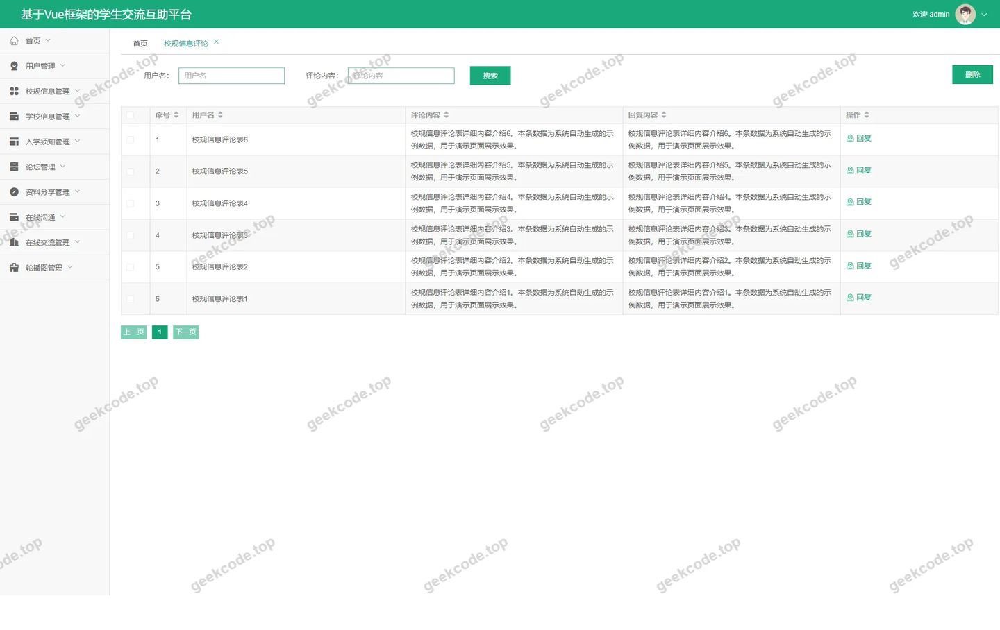</a>

<h4>后台-学校信息</h4>

<a href="https://geekcode.top/archives/springboot-%E5%9F%BA%E4%BA%8EVue%E6%A1%86%E6%9E%B6%E7%9A%84%E5%AD%A6%E7%94%9F%E4%BA%A4%E6%B5%81%E4%BA%92%E5%8A%A9%E5%B9%B3%E5%8F%B0?utm_source=github" title="查看完整源码">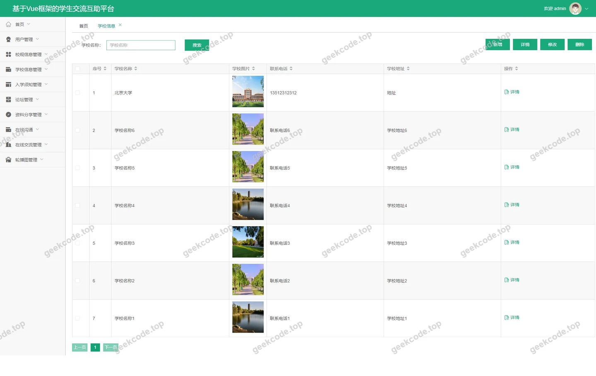</a>

<h4>后台-在线交流</h4>

<a href="https://geekcode.top/archives/springboot-%E5%9F%BA%E4%BA%8EVue%E6%A1%86%E6%9E%B6%E7%9A%84%E5%AD%A6%E7%94%9F%E4%BA%A4%E6%B5%81%E4%BA%92%E5%8A%A9%E5%B9%B3%E5%8F%B0?utm_source=github" title="查看完整源码">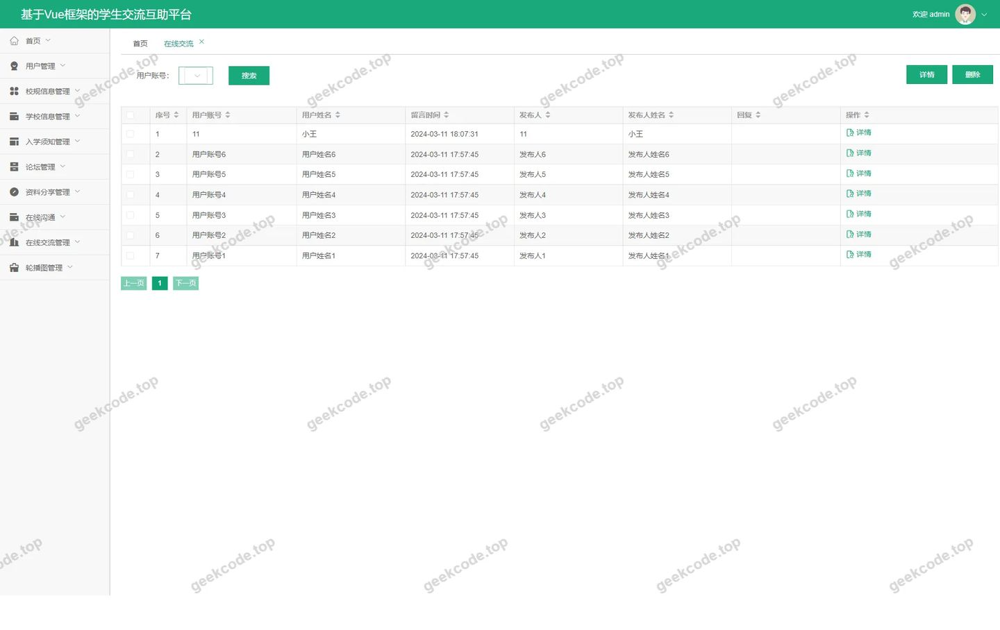</a>

<h4>后台-资料分享</h4>

<a href="https://geekcode.top/archives/springboot-%E5%9F%BA%E4%BA%8EVue%E6%A1%86%E6%9E%B6%E7%9A%84%E5%AD%A6%E7%94%9F%E4%BA%A4%E6%B5%81%E4%BA%92%E5%8A%A9%E5%B9%B3%E5%8F%B0?utm_source=github" title="查看完整源码">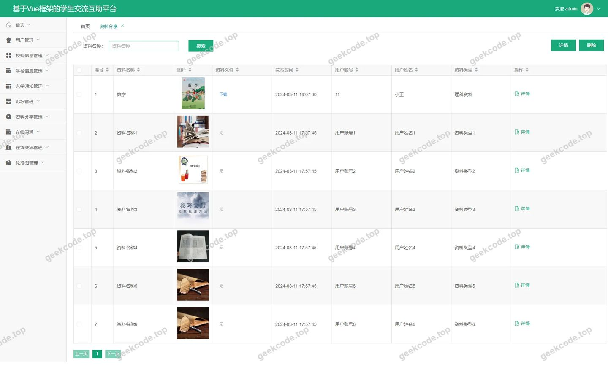</a>

---

## 获取完整源码

| 项目 | 说明 |
| --- | --- |
| 项目名 | [springboot]基于Vue框架的学生交流互助平台 |
| 运行截图 | 本文 12 张（站点带水印原图，仓库 `images/` 目录） |
| 完整源码 | [https://geekcode.top/archives/springboot-%E5%9F%BA%E4%BA%8EVue%E6%A1%86%E6%9E%B6%E7%9A%84%E5%AD%A6%E7%94%9F%E4%BA%A4%E6%B5%81%E4%BA%92%E5%8A%A9%E5%B9%B3%E5%8F%B0?utm_source=github](https://geekcode.top/archives/springboot-%E5%9F%BA%E4%BA%8EVue%E6%A1%86%E6%9E%B6%E7%9A%84%E5%AD%A6%E7%94%9F%E4%BA%A4%E6%B5%81%E4%BA%92%E5%8A%A9%E5%B9%B3%E5%8F%B0?utm_source=github) |
| 咨询微信 | **ir9372**（备注：jingpin-yuanma） |
| 更多项目 | [极客代码 geekcode.top](https://geekcode.top/?utm_source=github) |

> 需要源码、部署、改配置、跑不起来等问题，加微信 ir9372 沟通，说明项目名即可。
